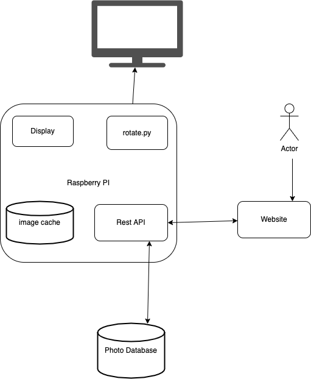

# Gallery

The REST API for piFrame: stores photos, tracks them in the photoDB Postgres
database, and tells the display which photo to show.

> **Branch `python-rewrite`:** this is the Python (FastAPI) rewrite. The Kotlin
> sources (`src/`, `build.gradle.kts`, Gradle wrapper) are still here for
> reference and can be removed once the Python version replaces them.



## Run it

Needs Python 3.10+, Docker and GNU make, with the
[photo-db](https://github.com/wasartin/photo-db) repo cloned next to this one as
`../photoDB` (or pass `DB_DIR=/path/to/photoDB`). From this folder:

```sh
cp .env.example .env  # optional: only if you need non-default settings
make start            # http://localhost:9009
```

`make start` creates `.venv` and installs dependencies if needed, starts the
photoDB containers, waits for Postgres, then runs the API. Ctrl+C stops the API;
`make stop` stops the database. Run `make` on its own to list every command.

If `python3` is older than 3.10, name a newer one: `make start PYTHON=python3.12`.

Open **http://localhost:9009/docs** for Swagger UI (or `/redoc`).

Without `make` (e.g. plain Windows PowerShell), from this folder, with the photoDB
containers already running:

```powershell
python -m venv .venv
.venv\Scripts\pip install -r requirements-dev.txt
.venv\Scripts\uvicorn app.main:create_app --factory --port 9009
```

## Tests

```sh
make gallery-test
```

Tests use a temporary SQLite database and image folder, so they don't need Postgres.

## Endpoints

| Method | Path | What it does |
|---|---|---|
| GET | `/v1/photos` | List photos (newest first) with size and dimensions |
| GET | `/v1/photos/{id}` | One photo's details |
| GET | `/v1/photos/{id}/file` | The image itself |
| POST | `/v1/photos/upload` | Upload an image (multipart `file`, optional `title`) |
| POST | `/v1/photos` | Register a file already on disk (old Kotlin behaviour) |
| PATCH | `/v1/photos/{id}` | Rename (`{"title": "..."}`) |
| DELETE | `/v1/photos/{id}` | Delete the row, and the file if the API uploaded it |
| GET | `/v1/current` | The photo the frame should show (`photo: null` → slideshow) |
| PUT | `/v1/current` | Choose it: `{"photoId": 3}` |
| DELETE | `/v1/current` | Clear the choice |
| POST / DELETE | `/v1/images`, `/v1/images/{id}` | Legacy base64 endpoints from the Kotlin API |
| GET | `/health`, `/actuator/health` | API and database status |

JSON keeps the Kotlin API's camelCase names (`photoId`, `filePath`, `created`).

## Configuration

Environment variables (see `.env.example`); defaults match `photoDB/docker-compose.yml`.

| Variable | Default |
|---|---|
| `DB_HOST` / `DB_PORT` / `DB_NAME` | `127.0.0.1` / `5432` / `pi_frame_displayable` |
| `DB_USER` / `DB_PASSWORD` | `pg-user` / `docket` |
| `DATABASE_URL` | overrides all `DB_*` values if set |
| `IMAGE_DIR` | `./images` |
| `MAX_UPLOAD_MB` | `25` |

## Database

The `photo` table is used as-is. On startup the API creates one new table if
it doesn't exist, `display_state`, which holds the currently selected photo:

```sql
CREATE TABLE IF NOT EXISTS display_state (
  dst_id INTEGER PRIMARY KEY CHECK (dst_id = 1),
  dst_current_photo_id INTEGER REFERENCES photo(pho_id) ON DELETE SET NULL,
  dst_updated TIMESTAMP DEFAULT CURRENT_TIMESTAMP
);
```

Photos uploaded through the API are stored in `IMAGE_DIR` and deleted with
their row. Photos registered by path (like photoDB's seed rows) are never
deleted from disk by the API.
